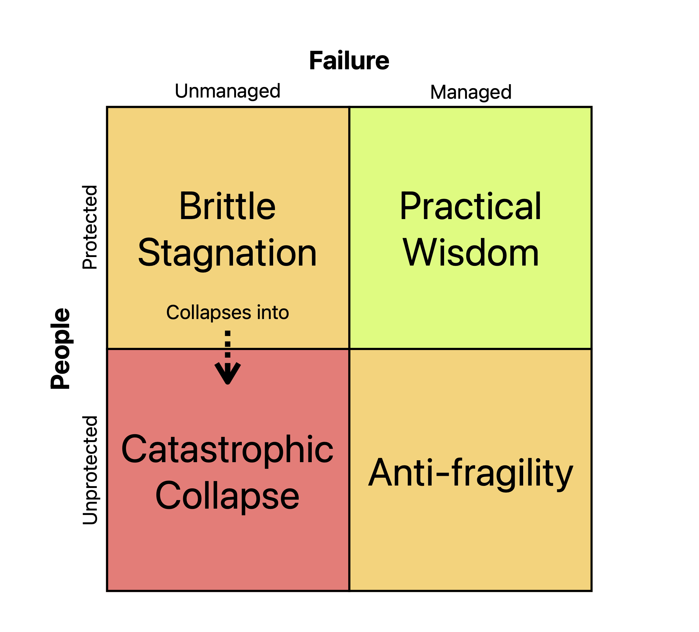

The fear of social collapse is real. Governments, when they recognise this, attempt to reassure us that society is stable. But stability is not the same as resilience, and the more stable a society may appear to be, the more it may have already spent the slack that would let it absorb real shock. Understanding these mechanisms can help us to recognise when claims of stability are genuine versus when these claims merely mask deeper structural failures that may actually accelerate collapse in denial.

Social institutions are complex systems, and all complex systems meet failure. Some systems treat failure as information to act upon, others treat it as a threat to be explained away and suppressed.

The instinct to deny failure is understandable. Institutions are built on commitments to people and social norms, admitting failure put all of that at risk. It's not ignorance, it's self protection. Recognising failure is difficult personally, and it's difficult institutionally too.

Apart from the instinct to deny, suppressing failure can be rational too. Admitting failure demands a response to it, and responding calls upon resources that are needed elsewhere. Denial may be cheaper in the short term, but in the long run suppressing failure can accumulate into crisis.

In ecology, C.S. Holling studied how natural systems respond to disruption, and he identified a pattern that runs across ecosystems, economies, and social structures. Systems in a growth phase are adaptive and responsive. As they mature, they become increasingly optimised; efficient, interconnected, and apparently stable. But optimisation and resilience trade off against each other. A maximally optimised system has eliminated the slack and redundancy that would allow it to absorb a shock. It has become, in Holling's terms, _rigid_. The appearance of stability is real – right up until it isn't. When disruption finally arrives, the accumulated brittleness releases all at once. Holling called this the _rigidity trap_: the very success of a system in excluding disturbance makes its eventual failure more catastrophic.

This is what denial produces at scale. Failure doesn't disappear when it's suppressed, it accumulates. The longer the suppression, the larger the eventual release. 

Managed processing of failure is better than unmanaged failure and denial, but not all managed processing is the same. When failure occurs who bears the cost? 

Some systems distribute it fairly, across the whole. Others concentrate it on a section of the population. At worst it is the most vulnerable, those with the least power to object, who suffer the most. Both may be described as processing failure honestly, but only one actually is.

N.N. Taleb argues that some systems improve in response to stress, that controlled exposure to volatility, shocks, and small failures makes them stronger, while over-protection leaves them brittle. This property is called _anti-fragility_.

To be clear, the concept as used here is not a faithful expression of Taleb's theory. Taleb himself insists that those who take the gains of success must most bear the cost of failure. My use of anti-fragility is an abuse of the idea, pushed to the extreme.

In society, the stressors that strengthen the system are never free, those costs land on people. And the same reasoning that prizes systemic strength can be used to justify their suffering as an acceptable cost of improvement. Processing failure honestly requires protecting people from harm, harm caused by failure and harm caused by responding to that failure.

## The Failure Map

These observations give us two dimensions that we can use to understand social collapse: whether failure is managed or unmanaged; and whether people are protected or unprotected through crisis. Putting those together we can create a map to set out different types of societies and understand the relationships between them.

Anti-fragility sits in the bottom right, where failure is managed, but people are unprotected.

The top left quadrant, where failure is unmanaged but people are protected, I call _brittle stagnation_. This is the one that looks most like a responsible, caring society, and is the hardest to see as failing from the inside. A society that is unable (or unwilling) to acknowledge its failure, while maintaining support for those who suffer as consequence of this failure, looks like it is protecting people. Which it is, but it's doing so by borrowing against a future reckoning.

The protection is real, but so is the brittleness that accrues. Eventually the accumulated pressure releases, and the system is no longer able to protect its people, collapsing into the lower left quadrant: _catastrophic collapse_.

Holling gives us one description of this mechanism, but there are others. Joseph Tainter found that societies grow in complexity in response to problems, but the cost of maintaining that complexity eventually becomes too much to bear. Peter Turchin explained collapse in terms of elite overproduction, that when elites multiply faster than positions available to them competition turns inwards, tearing society apart. Luke Kemp investigated over 300 cases of societal collapse finding that collapse is driven by inequality and the cost of sustaining social hierarchy. Four accounts of collapse, each suggestive not conclusive, but all converging on the same catastrophic outcome.

The pattern these accounts describe looks, to me, like the preset moment. Declining institutional trust. Degrading capacity for political compromise. Elites competing in a shrinking space. The sense that the existing order is no longer able to process its own failures honestly.

This is a reading not a conclusion. If trust in institutions recovers, if political polarisation reverses, if elite competition diminishes, then this reading would be wrong, or at least premature. But if I am wrong the failure map still stands as a tool, a diagnostic instrument. It holds regardless of what it finds.

The final quadrant, where failure is managed and people are protected through crisis, is the society we all hope to live in. A good society, one that grants the opportunity for a good life to all its people. I call this _practical wisdom_.

## A Good Society

Practical wisdom isn't an arbitrary label to fill a gap in the map, it's a borrowed term and it well describes a good society.

We want to understand what a good society looks like, but let's ask a narrower question first: what does a good life look like? How should one live?

The answer cannot be a rule book, no one can tell you exactly what you should do in every moment of your life. There's no formula to follow that dictates good behaviour, what we have instead is a way of living. We act, guided by what we value. We reflect honestly on whether our behaviour upheld our values. And, if not, we repair harm caused and commit to do better. And the values we choose to hold, they give weight to human suffering, both ours and others. This is the habit of a good life, and I call it practical wisdom.

The term is borrowed from translations of _phronesis_, a concept discussed by Aristotle. It's a simple account of one person striving to live well, built from the ground up, with no outside authority to appeal to.

So, why does this apply to a good society?

Society is not a person, it cannot hold a practice in the same way we can. At the social scale, the practice is carried not by a self but by structures – institutions built to recognise failure, cultures that permit honest accounting of mistakes, and political arrangements that incentivise correction before collapse. The core movements are the same, so we can recognise a good society in the same terms that we recognise our own good lives.

A good society must process failure honestly, just like we do. It must reflect on its actions, repair its harm and commit to do better. And a good society must be guided by values, values that recognise that suffering has moral weight and should be addressed where it's felt. The same practice that applies to our good lives also applies to society too.

This means that we can hold society to account using the same toolkit we apply to ourselves. We can ask if mistakes are faced honestly or explained away, if repair is meaningful or superficial, and if values are upheld or undermined. Is failure being processed or denied? How is the cost of correction shared? Do policies make a good life more attainable? Do institutions recognise and reduce suffering? You do not need permission to ask these questions of society any more than you need permission to ask them of yourself. Society is answerable to you, where you stand.

This is the subject of my new book, **[No Fixed Ground: On Living in Uncertainty](/no-fixed-ground/)**. In it I make the case that if a society’s survival conflicts with its members’ good lives, then that society cannot be good. So, a good life is only possible when the interests of society are aligned with the interests of the people living in it. A good life and a good society demand the same things.

The failure map helps us to see where we're going wrong, and what the costs are if we continue. But it also shows us what we need to do to put it right, honest reflection of mistakes and attention to suffering wherever it is found. Collapse is not inevitable, we have a choice, and that choice begins with us.

---

**[No Fixed Ground: On Living in Uncertainty](/no-fixed-ground/)** is available now on **[Amazon US](https://www.amazon.com/No-Fixed-Ground-Living-Uncertainty/dp/B0HMM1C75W/)**, **[Amazon UK](https://www.amazon.co.uk/No-Fixed-Ground-Living-Uncertainty/dp/B0HMM1C75W/)**